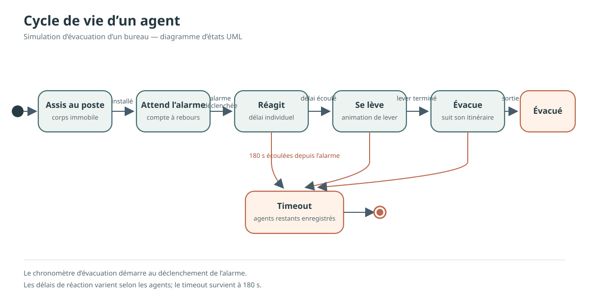
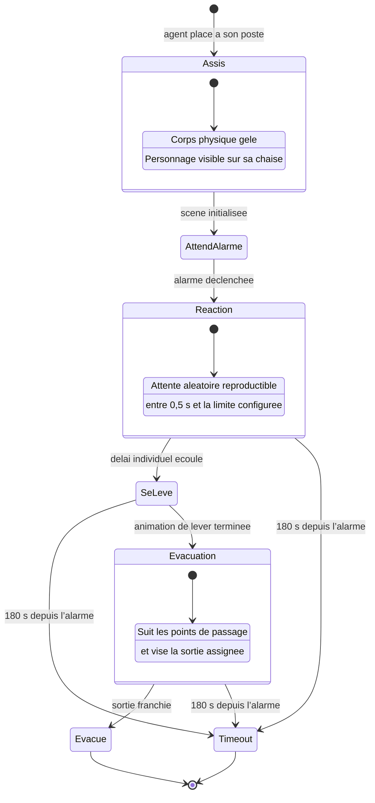

# Diagramme d’etats d’un agent

Ce diagramme represente le cycle de vie d’un agent dans la simulation. Le compte a rebours avant l’alarme est gere par la simulation; le delai maximal de 180 s commence au declenchement de l’alarme.

## Correspondance avec le code

- `Assis` et `AttendAlarme` : l’agent est cree gele et attend l’appel `start_evacuation`.
- `Reaction` : le delai individuel est decompte apres l’alarme.
- `SeLeve` : une animation redresse le corps avant de liberer sa physique.
- `Evacuation` : l’agent suit ses waypoints, evite les voisins et avance vers sa sortie.
- `Evacue` : l’agent franchit sa porte et emet le signal de sortie.
- `Timeout` : la simulation s’arrete a `duree_max` et consigne les agents encore presents.

## A reproduire dans Modelio

Creer un **Diagramme d’etat** et placer les etats `Assis`, `Attend l’alarme`, `Reagit`, `Se leve`, `Evacue` et `Bloque / timeout`. Relier-les dans l’ordre indique dans le diagramme; ajouter les gardes `alarme declenchee`, `delai individuel ecoule`, `animation terminee`, `sortie franchie` et `180 s depuis l’alarme`. Les etats `Evacue` et `Bloque / timeout` sont terminaux.